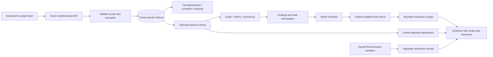

# dots-dash: product, scope and completion audit

Audit date: 21 October 2026. Source baseline: `a059e971af73b4a830690426e9fdf1f89afcdee4`.
This document reconciles the product requirements with the current reusable application and saved execution evidence. It is not production acceptance or a new grant of access. [Proposed experience mockups](mockups/product-review.html) are synthetic design artifacts, not shipped screens.

## Subsequent bounded implementation

The [correspondence-first Overview](OVERVIEW.md) now implements the next local composition described by this audit, with 18 isolated UI/API/storage observations and explicit snapshot limits. The baseline matrix and older hashes below remain historical to `a059e97`; this follow-up does not close live correspondence/calendar, actual-user acceptance or production gates. Mockups remain proposals.

## What the product is for

dots-dash should let one person understand and manage assistant-supported work: correspondence, commitments, scheduled work, requested outcomes, actual results, remaining work and decisions that need the owner. Correspondence and scheduled tasks are the original first priorities. Engineering review is an extension of that purpose, not the entire product.

The intended daily outcome is simple: find the relevant correspondence, next personal commitment and next decision within ten seconds each; inspect evidence for what was done; know what remains and why. A person should never have to interpret a passing checklist as proof that an email was sent, a product works, or all sessions were reviewed.

The reusable product should eventually let another owner install a separate private instance and connect their own supported assistant. That setup is not complete. The current application has useful local storage, views and engineering review workflows, but does not provide live inbox/calendar synchronization or delivery into an existing assistant conversation.

Primary audience: the individual owner. A future audience is another independent owner. A developer/operator reviewing coding work is a repository-supported extension. Shared-team SaaS, a public personal dashboard, an autonomous agent fleet and a replacement for every source service are not established requirements. Career opportunities are one category alongside consulting, project/advice work, general projects and travel.

This synthesis uses the [PRD's FR01–FR23](build-package/02-prd-v2.md), [technical specification](build-package/03-functional-technical-spec.md), [UX journeys](build-package/06-ux-flows.md) and a separately supplied, bounded review of original user intent. Private quotations and message identifiers are deliberately omitted. Neither that research nor this audit reviewed all correspondence. Ambiguous spoken product names do not introduce a second product or a “40-agent” requirement.

## What exists, in plain language

- An owner-gated web application stores imported work records, instructions and decisions. Saved instructions remain **not delivered**. Decisions do not execute external actions.
- Correspondence, schedule, requests, projects and opportunity views display stored snapshots with source context. Refresh reads the database; it does not fetch a mailbox or calendar.
- An optional Python extension accepts explicitly selected, already-sanitized exports. It displays supplied goals, expected behavior, actions, claims, corrections, rule-based findings and remediation prompts.
- Owners can select a small declarative skill checklist, explicitly run it when enabled and record what they observed. A checklist receipt is real execution of those checks, not a provider agent or the original skill instructions.
- A separate inventory records owner-reported access and snapshot metadata. Associations link snapshots to reviews without proving access. Retained-record reports track which normalized items an owner says they reviewed; they do not certify original transcript processing.
- A fixed, application-owned local browser workflow and read-only receipt viewer provide a narrower form of observed verification. These are not arbitrary product testing or live agent execution.
- Python read compatibility and disposable mutation/recovery rehearsals exist. The live core writer is still Node; full Python cutover is unfinished.

The source is published. License selection remains pending, so this is not described as a fully licensed open-source release. This audit did not inspect or change a live deployment.

## Product and deployment boundaries

| Boundary | What belongs there | What it does not establish |
|---|---|---|
| Reusable dots-dash repository | Generic React/TypeScript UI, Node API, SQLite schema, Python extension, sanitized examples, project skills and documentation | Access to an owner's accounts or hosted dashboard |
| Owner-private instance | Identity bindings, private records, database, source grants, runtime evidence and deployment configuration | Permission to publish that material |
| Historical private hosted prototype | Its own host/authentication/storage integration | Equivalent working integration in this reusable package |
| Selected session review | Owner-curated normalized inputs and supplied provenance | Original-file reads, all-session ingestion or independently proven authorship |
| Bounded runner | Fixed declarative checks; separate fixed local browser producer | General command runner, provider agents, subagent fleet or terminal control |
| Operator rehearsal tools | Disposable copies, fixed operations, owned handles, fencing and reconciliation | Production writer cutover or recovery of arbitrary lost processes |

See [architecture](ARCHITECTURE.md), [application setup](APPLICATION_SETUP.md) and [migration plan](build-package/14-python-migration-and-v3-acceptance.md). Use isolated storage per owner. A single-owner schema does not establish safe shared tenancy.

## Actual screens and how to reach them

These are current navigation targets, not the redesigned mockups. Source: [dashboard](../ui/dashboard.tsx#L12), [Day workspace](../ui/day-workspace.tsx#L7), [history views](../ui/history-views.tsx#L10).

| Screen | Current behavior | Remaining experience gap |
|---|---|---|
| Overview | Saved-instruction composer, commitments, application/blocked counts, receipts, history and schedule summaries | Correspondence/schedule/Needs you should lead the experience; current application-oriented counters narrow the broader product story |
| Correspondence | Search and direction filters over imported messages, source/time/participant context | Complete thread model, reply basis, generic providers and real sync |
| Schedule | Imported event list; organization subscriptions excluded by default | Calendar/week navigation, owner-local zones, recurrence/cancellation and itinerary depth |
| Requests | Search/filter commitments; requested/completed/pending/next/needs-owner fields and linked evidence | Full request-to-actual-outcome acceptance and clearer verification basis |
| Opportunities | Role, consulting, project/advice and unclassified views; detail history | Complete generic multi-association behavior and provider-backed updates |
| Projects / Work | Imported project/artifact summaries and task detail | Rich cross-domain graph; generic project navigation instead of a single Work shortcut |
| Decisions | Historical bounded decision records with no execution claim | Action-time executor integration and secure handoff |
| Activity / Observations | Saved events and observation projections | Complete generic attempt/outcome and correction history |
| Sources | Source metadata, snapshot coverage and explicit disconnected sync | Verified onboarding, real source health and incremental coverage |
| Day & projects | Review-day filter, project evidence, copied next-work drafts, legacy skill/config coverage | Actual daily activity accounting across all sources; review day is not action day |
| Day & projects → Session review | Import, review selector, goals/events, remediation, local checklist, observations, links, inventory, associations, retained reports and browser receipts | Dense single-page experience; no broad transcript reader or provider run console |
| Instructions panel | Save and copy a contextual instruction | Delivery remains unconfigured; no fabricated conversation reply |
| More | Secondary destinations on narrow layouts | Full keyboard/screen-reader and mobile journey acceptance remains open |

## How data and actions flow

The API derives owner from the configured server authentication adapter, checks same-origin writes and bounds input. Without authentication or owner configuration, private API access denies. Core work/history uses Node and SQLite. The engineering transport launches one fixed Python worker over pipes, with a ten-second timeout and a restricted environment. Input cannot choose an executable, shell command or credentials. See [API boundary](../server/api.ts#L16), [host configuration](../server/start.mjs#L19) and [worker transport](../server/engineering.mjs#L5).

Imports, local checks, context links, inventory, associations and owner-review reports each have explicit host capability controls. They default off. The owner-report companion migration is an explicit operator action; enabling its API does not apply it. Ordinary selected-record normalization does not require that migration.

### Correspondence to accountable work

The target domain is source message → Request → Task → proposed Action → actual Attempt → Evidence → Outcome. Saving, delivery, acceptance, activity and completion must remain distinct. An accepted request can be incomplete even when one action passed. A later correction preserves the earlier outcome. Resolving a Needs you item grants no unrelated authority. This complete lifecycle is specified; current records and local views implement only parts of it. [Domain/API targets](build-package/04-domain-event-schema.md), [bridge specification](build-package/07-connectors-and-bridge.md).

### Selected-record review

The owner supplies `dots-visible-session` v1, or the optional `dots-selected-records` v1 admission envelope. No source references are fetched. The latter records supplied attribution and explicit project binding, excludes classified tool/generated/private material and retains field-level exclusion reasons. A sensitive keyword alone does not discard a safe goal. Unknown origin stays unknown. Redaction is defense in depth; the input must already be sanitized.

Goals, steps, associations and skill applicability come from the supplied export. Deterministic rules find missing or conflicting evidence; they do not semantically reconstruct a full conversation. Derived prompts preserve correction scope, attribution uncertainty and project-binding basis while retaining the original draft. Historical text is evidence, not execution authority. [Admission](SELECTED_RECORD_ADMISSION.md), [derived context](DERIVED_REMEDIATION_CONTEXT.md), [rule implementation](../python/dots_engineering/review.py#L5).

### Selection coverage is not transcript completeness

Six separate facts must remain separate: documented source route, scoped permission, observed source bytes, sanitized selection, snapshot association, and actual processing coverage. The current inventory/association path principally records owner assertions. A reviewed retained-selection manifest is a seventh, narrower fact: an owner reports reviewing these normalized items under `owner-record-review` version 1.

For items 1–5, reports on 1, 2, 4 and 5 mean four reviewed and a contiguous prefix of two. Filling item 3 advances the prefix. Correction or withdrawal can retreat it without rewriting history. Excluded records and unknown authorship remain separate; the original transcript denominator and time coverage remain unknown. Import success, a checklist pass or an association never advances this review history automatically. [Coverage contract](build-package/16-source-coverage-checkpoints.md), [owner reports](OWNER_REVIEW_REPORTS.md).

### Verification and uncertain outcomes

An imported completion claim is a claim. A recorded user observation is owner-reported. A local checklist receipt attests only its declared checks. A fixed owned browser receipt attests its bounded workflow and measured inputs. Read-time relevance can become stale or unknown while the original result remains unchanged. The standard server does not bind every runtime measurement; unchanged files do not prove complete environment equivalence. [Receipt adapter](OWNED_BROWSER_RECEIPTS.md), [runtime relevance](BROWSER_RUNTIME_RELEVANCE.md).

The draft Session review fix retains an immutable request envelope while mounted. An unconfirmed POST blocks conflicting writes and offers exact reconciliation; confirmed POST plus failed GET offers read-only refresh. Leaving/reloading loses the envelope. Owner-review reports have a separate mounted-envelope and operation-lookup contract. Neither is durable cross-device recovery. [Session recovery](SESSION_REVIEW.md), [recovery evidence](verification/session-save-recovery.json).

## Completion register

**Implemented + verified** below means a bounded implemented path has recorded isolated acceptance, with its revision and limits. It never means production-certified or rerun in this audit. **Implemented + unverified** means code exists without sufficient end-user evidence for the stated outcome. **Partial** means important pieces work but the feature set is incomplete. **Planned** means specification/proposal only. **Blocked** identifies a missing external prerequisite or decision. Mixed statuses are deliberate: a feature can contain verified local behavior and blocked integration.

| Requirement | Owner outcome | Status at baseline | Code/evidence and specific remaining gap |
|---|---|---|---|
| FR01 Privacy and owner access | Start empty; only correct owner can access records | Partial; local denial/isolation verified, production blocked | [API](../server/api.ts#L16), [setup](SETUP.md), E1/E4/E5 below. Real identity adapter, signed-in acceptance, independent-owner bootstrap/revocation remain open |
| FR02 Correspondence | Understand conversations, actor, source and reply need | Partial | [History view](../ui/history-views.tsx#L18), [history import](../lib/work/history.ts#L3). Bounded Gmail-specific importer, not live provider sync; complete thread/reply and attribution workflows unverified |
| FR03 Schedule and itinerary | Know next personal commitment and changes | Partial | [Schedule view](../ui/history-views.tsx#L20), [contracts](../lib/work/contracts.ts). Imported list exists; owner-local zone/DST/recurrence/cancellation/travel acceptance and live integration open |
| FR04 Request accountability | See requested, done, pending, next and needs-owner | Partial | [Commitments](../ui/commitments.tsx#L6), [context links](REQUEST_CONTEXT_LINKS.md), E1. Local linking verified with TEST DATA; actual-user V301 and full action/outcome lifecycle open |
| FR05 Decisions | Approve exact scope without accidental execution | Partial | [API](../server/api.ts#L99), [decision rehearsal](PYTHON_DECISION_REHEARSAL.md). Durable local decision, executed false; real executor/secure handoff absent |
| FR06 Opportunities | Track roles, consulting and advice work with history | Implemented + unverified for complete user outcome | [Views](../ui/history-views.tsx#L16), [validation](../lib/work/history-validation.mjs). Full multi-source and navigation acceptance not established by this audit |
| FR07 Projects | Link work, correspondence and artifacts without duplicate counts | Partial | [Project view](../ui/history-views.tsx#L19), [context contract](REQUEST_CONTEXT_LINKS.md). Broader graph is planned; context candidate listing is bounded to 50 requests |
| FR08 Durable history | Preserve failures, corrections and unknown attribution | Partial; engineering append-only paths verified | [Core history](../lib/work/history.ts), E1–E5. Generic record upsert/audit is not the full target domain revision/outbox model; retention/export/restore open |
| FR09 Source health | Know account, coverage, freshness and unavailable states | Partial; inventory/access path verified | [Inventory](SOURCE_INVENTORY.md), [pagination](SOURCE_INVENTORY_PAGINATION.md), E1. Access observations are owner-reported; verified original readers and live health absent |
| FR10 Assistant bridge | Save, deliver, accept, execute and confirm separately | Partial save/copy; bridge blocked/unconfigured | [Dashboard](../ui/dashboard.tsx#L25), [bridge](build-package/07-connectors-and-bridge.md). No supported intended-conversation delivery receipt or revoke acceptance |
| FR11 Durable updates | Work continues with browser closed; recover gaps | Planned beyond local persistence | [Technical target](build-package/03-functional-technical-spec.md). Ingestion workers, atomic outbox, resumable SSE and live reconciliation not shipped as a complete path |
| FR12 Notifications | Receive meaningful opted-in alerts | Planned | [PRD](build-package/02-prd-v2.md). No notification delivery, quiet-hour or dedup acceptance; displaying a task is not scheduling it |
| FR13 Engineering context | Move request → project/review → request safely | Implemented + verified locally; actual-user outcome unverified | [Context UI](../ui/context-links.tsx), E1. Owner/project pins and uncertainty paths tested; V301 actual authorized correspondence/repository trace remains open |
| FR14 Session review | Review permitted selected evidence and intent | Implemented + verified for curated contracts; provider breadth blocked | [Session review](SESSION_REVIEW.md), E1/E2. Claude/OMP/Cursor/Codex readers unavailable; no all-session or source-byte coverage |
| FR15 Skills/config | Know applicable guidance and its exact version | Partial | [Day config view](../ui/day-workspace.tsx#L15), [skill workflow](SKILL_WORKFLOW.md), E6. Metadata/checklists and manual-use process exist; installed inventory/config reader/full-skill execution not in app |
| FR16 Completion evidence | Separate edited/tested/committed/pushed/deployed | Partial; bounded receipt/relevance paths verified historically | [Owned receipts](OWNED_BROWSER_RECEIPTS.md), [artifact display](ARTIFACT_EVIDENCE_DISPLAY.md). General trusted result ingress, production equivalence and full V310 open |
| FR17 Host/workspace | See approved host and read-only terminal | Planned | [Engineering design](build-package/13-engineering-contexts-and-execution.md). No application host adapter or ordered terminal stream; local process helpers are narrower |
| FR18 Bounded execution | Authorized commands, real children, cancellation and safe recovery | Partial foundations; general execution planned | [Local runner](../python/dots_engineering/runner.py#L13), [supervision](OWNED_PROCESS_SUPERVISION.md). Fixed checks/browser/rehearsals only; no provider fleet, arbitrary shell, child DAG or complete V305–V309 |
| FR19 Daily summary | Understand daily activity and copy next work | Partial | [Day workspace](../ui/day-workspace.tsx#L7). Saved review-day projections/prompts, not all-source activity recap or scheduled generation; full V312 open |
| FR20 Python first | Preserve compatibility and safely migrate writers | Partial | [Migration plan](build-package/14-python-migration-and-v3-acceptance.md), [read compatibility](PYTHON_READ_COMPATIBILITY.md), [rehearsal](REPLAY_AND_HANDOFF_REHEARSAL.md). Node remains core writer; full V314 cutover/rollback incomplete |
| FR21 Observable acceptance | Distinguish claim from performed steps/result | Implemented + verified for owner reports and bounded checks | [Observation form](../ui/session-review.tsx#L23), E3/E5. Owner attribution remains explicit; no universal independent verifier |
| FR22 Drift and remediation | Explain evidence gaps and preserve scoped corrections | Implemented + verified within rule-based selected review | [Correction display](CORRECTION_CONTEXT_DISPLAY.md), [derived context](DERIVED_REMEDIATION_CONTEXT.md), E1/E3. No automatic fix, semantic all-history analysis or automatic cross-review merging |
| FR23 Skill evidence | Selection is not invocation; outcomes retain scope | Implemented + verified for local checklist; partial broader workflow | [Runner](../python/dots_engineering/runner.py#L19), E1/E3/E6. Manual skill-use record is self-reported guidance application; no host-wide automatic invocation guarantee |
| Coverage companion | Browse inventory, assert associations, report retained review | Implemented + verified locally, original processing planned | E1/E4. Default-off independent gates; version 1 only; 1,000-event cap not fully exercised; no source-access or processing certificate |
| Independent/mobile release | Separate owner setup and accessible daily use | Partial web foundation; native iOS planned | [Release roadmap](build-package/12-release-roadmap.md). Some narrow-layout/focus checks exist; full screen-reader, second owner, backup, security, license and production gates open |

## Evidence register and freshness

The following reports were parsed and their `sourceHashes` compared with baseline files during this audit. A matching hash establishes byte correspondence, not a new runtime execution. A changed binding keeps the older observation historical; it does not automatically establish a regression. No application/database/provider acceptance was rerun for this documentation task.

| Evidence | Saved observations | Bindings matching current source | Use and limits |
|---|---:|---:|---|
| E1 [Source-review publication](verification/source-review-publication.json) | 86 entries, including disclosed corrected/discarded measurements | 64 / 71 | Isolated inventory, 51-item pagination, links, corrections, associations, checklist. Shared API/worker/UI files later changed |
| E2 [Selected admission](verification/selected-record-admission.json) | 28 | 5 / 8 | Safe keyword, actual redaction, attribution, project ambiguity, scoped corrections. API/UI and synthetic fixture later changed |
| E3 [Derived remediation context](verification/derived-remediation-context.json) | 32 | 8 / 10 | Context retention, failing owner observation survives checklist. API/UI later changed |
| E4 [Owner review reports](verification/owner-review-reports.json) | 52, plus two physical-owner checks | 12 / 13 | R1–R4/R6–R10 in stated scope; R5 rejects unsupported version. Shared Session review UI later changed |
| E5 [Session save recovery](verification/session-save-recovery.json) | 20 | 6 / 6 | Actual rendered UI/API/storage recovery for lost run/observation responses and failed post-save GET. Mounted memory only |
| E6 [Skill workflow](verification/skill-workflow.json) | 10 manual routing scenarios and six-file source audit | Skill hashes checked in its recorded pass | Both project skills structurally validated. Manual scenarios are not independent host invocation tests |

Additional historical implementation reports cover [owned browser receipts](OWNED_BROWSER_RECEIPTS.md), [53-run receipt pagination](BROWSER_RECEIPT_PAGINATION.md), [dependency/environment relevance](BROWSER_RUNTIME_RELEVANCE.md), [artifact roles](ARTIFACT_EVIDENCE_DISPLAY.md), and [rehearsal lifecycle/fencing](LIFECYCLE_RACE_GUARDS.md). They are supporting scoped evidence, not current full-product certification. Many raw artifacts were intentionally omitted from the public package.

Publication state observed in this audit: main is the previously merged `1d79dc5f9f762fe21e7857cbfab4b45eeebb6150` baseline; [draft PR #2](https://github.com/krzemienski/dots-dash/pull/2) was confirmed open/unmerged at `a059e971af73b4a830690426e9fdf1f89afcdee4`. [Its Source checks](https://github.com/krzemienski/dots-dash/actions/runs/39576142674) succeeded for that head. This product document and mockups are separate local work; that CI result does not cover them.

### Historical statements reconciled

| Earlier wording | Current interpretation |
|---|---|
| Inventory pagination and eight association cases unperformed | E1 later exercised their principal isolated paths, including 51 inventories and replacement/history/revocation. Not every fault permutation or production workflow was performed |
| Context links blocked from all runtime acceptance | E1 covers local synthetic linking and uncertainty. Actual-user V301 remains unverified |
| Clean install unverified | E1 records clean install with an isolated cache, then 14 tests/typecheck/build. Earlier offline cache failure is historical |
| All processing coverage is unimplemented | Original-source processing remains unimplemented. E4 adds separate owner-reported review of retained normalized items, not processing certification |
| Post-save GET failure untested | E5 covers Session review's confirmed-save/failed-refresh case. Do not generalize it to every endpoint |
| Python only proposed | Engineering extension/read compatibility/rehearsals exist. Full live writer migration remains incomplete |

Historical ledgers are retained unchanged. Navigation notes and the current index should point here instead of deleting earlier limitations.

## Ten prioritized unfinished outcomes

This sequence favors the original daily owner outcome over adding more execution machinery. Priorities are recommendations within existing scope, not permission to connect accounts, send messages or deploy.

| Priority | Deliverable | Observable acceptance before calling it complete |
|---|---|---|
| 1 | One coherent daily check-in | With a scoped fixture, owner finds relevant message, next commitment and one decision within ten seconds each; snapshot age and unknown source coverage remain visible. Then repeat with an authorized real owner |
| 2 | Request accountability through evidence | Trace one actual authorized request to its task/review and back; each Done item has supporting evidence, partial/fail remains visible, no authority crosses the link. This is actual-user V301, still open |
| 3 | Durable uncertainty recovery for existing writes | Lost response, reload and a second view reconcile the original operation without duplicate effects or exposing payload in browser storage; not-found remains uncertain. Define read-only lookup before new retry affordances |
| 4 | Accessible review and navigation | Keyboard and screen-reader complete import/review/correction/recovery; focus returns correctly, 320/375px long text does not overflow, errors and empty states are announced. Current 390px checks are not this full gate |
| 5 | Truthful source onboarding and admission | Supported route, owner grant, account identity, observed bytes, sanitized selection and retained review shown separately. Reject wrong owner/project, retain noncontiguous intervals and unknown denominator. No reader advertised before its own evidence |
| 6 | First real correspondence integration | Authorized inbound/outbound items normalize idempotently; source thread/time/actor and reply basis survive reload; revoke/partial read preserves last-success and gaps. No send button without separate action path |
| 7 | Personal calendar and scheduled-work distinction | Actual authorized reschedule/cancel, all-day/DST/recurrence and owner/source zones render correctly. Provider schedule definition and actual run receipt remain distinct from calendar attendance and calculated next run |
| 8 | Intended-assistant delivery boundary | A supported destination-bound transport proves delivery and acceptance, then revocation. If route unavailable, saved/copy stays the supported outcome; alternate model response cannot impersonate the existing assistant |
| 9 | Verifiable execution foundations | First advertise only a defined fixed capability with revision/scope pins, cancellation/unknown reconciliation and actual owned evidence. Add provider/child runs only after V305–V309/V313 prerequisites, never by rebranding the checklist |
| 10 | Independent release and migration | Second owner starts empty with own identity/storage; backup/restore and revocation work; Python parity/cutover/rollback preserve history and permissions; license and production gates resolved before general release |

Next independently useful implementation prompt: **Improve the existing Overview composition using stored correspondence, schedule and commitment records. Lead with these three owner questions and explicit snapshot/coverage context. Preserve save-not-delivered and decision-not-executed behavior. Define a synthetic end-user navigation scenario first; verify focus, empty/error states, narrow widths and linked evidence. Do not add a provider, scheduler, new data source or live action.**

This is proposed next scope, not implemented by this audit. It should be reviewed against the mockup before a broad UI change. Request candidate pagination beyond 50 is another concrete bounded discoverability gap visible at [the API](../server/api.ts#L45); its acceptance needs a 51-request fixture without conflating request and inventory pagination.

### Existing acceptance gates, without blanket completion claims

The [F01–F23 plan](build-package/11-verification-plan.md) and [V301–V315 plan](build-package/14-python-migration-and-v3-acceptance.md) remain the detailed procedures. This audit does not close any gate by source inspection alone.

| Gates | Evidence boundary / remaining acceptance |
|---|---|
| F01–F02 install/auth/isolation | Clean local install and synthetic-owner denial/isolation observations exist; real signed-in and revoked production sessions remain open |
| F03–F05 correspondence/import/navigation | Validation and isolated import checks exist; controlled real mailbox/thread and complete Back/Forward journey remain open |
| F06–F08 calendar/time/scheduler | Live create/reschedule/cancel, DST/recurrence and provider-run acceptance remain open |
| F09–F12 accountability/decision/instruction/bridge | Local records and saves are implemented; whole real request outcome and intended-assistant delivery/revocation remain open |
| F13–F16 interruption/updates/corrections/import coexistence | Targeted local replay, correction and compatibility evidence exists; live sync/stream and all generic history cases remain open |
| F17–F18 hostile input/sanitization | Targeted schema/redaction/owner checks and outgoing-history review exist; not a universal secret detector or full security audit |
| F19–F21 accessibility/recovery/second owner | Narrow viewport/focus checks exist; screen-reader, backup/restore and independent-owner journey remain open |
| F22 update latency | No 100-update connected-client measurement established; five-second target is not achieved by specification |
| F23 publication/CI/deployment | Exact branch SHA and CI verified separately; production deployment not performed |
| V301–V304 request/session/config boundaries | Synthetic context/admission cases exist; actual-user request and each named provider/config route require separate proof. No protected-path probe is needed or authorized here |
| V305–V309 terminal/commands/children/fencing/cancel | Fixed local producers and disposable fencing are narrower evidence; full host/agent scenarios remain unperformed |
| V310 claims and verification | Owned fixed browser receipts and relevance projections are useful partial evidence; general current product/environment verification remains open |
| V311 redaction | Selected-record canaries/control filtering have scoped evidence; real terminal-stream sanitization is not established |
| V312 daily summary | Stored review-day projection is not complete real-event daily accounting |
| V313 revocation | Capability rejection/replay cases exist locally; general running host/session adapter revocation remains open |
| V314–V315 migration/independent owner | Disposable parity/fencing and storage-owner negatives do not close whole-app cutover/rollback or second-owner installation |

The owner-report R1–R10 and source-admission A1–A8 suites have different subjects. R-series evidence concerns retained normalized records. It must not be used to mark the broader original-source A-series complete.

## Mockup package and design contract

Open [the self-contained proposal](mockups/product-review.html). Five navigable plates cover ten experiences:

1. **Today:** daily overview plus personal schedule versus scheduled work.
2. **Request:** accountability detail plus uncertain-operation recovery.
3. **Sources:** bounded coverage plus onboarding states.
4. **Review:** intent/drift plus context-preserving remediation and skill evidence.
5. **Verify:** claim/report/receipt comparison plus future run detail explicitly unavailable.

All rows and counts are TEST DATA. Only proposal navigation/disclosures work; there is no save, send, connect, run, provider request or live dashboard data. Existing semantics are shown alongside proposed composition, with unavailable capabilities named. Mockup screenshots are design review evidence only, not application acceptance.

Rendered proposals: [Today](mockups/today-desktop.png), [Request and recovery](mockups/request-desktop.png), [Sources and onboarding](mockups/sources-desktop.png), [Intent and remediation](mockups/review-desktop.png), [Verification and future runs](mockups/verify-desktop.png), [375px source coverage](mockups/sources-mobile.png).

The repository calls for flat-black surfaces, near-white type, restrained accents and no decorative gradients. The proposal keeps that direction and uses limited purple/pink for selection/action emphasis. Product density, clear dividers and an evidence trail replace decorative cards. The most important visual distinction is claim → owner report → scoped receipt → remaining acceptance. No unrelated product branding is imported.

The frontend-design guidance was read and manually applied to hierarchy, tokens, interaction states and responsive composition. Session-intent-review guided evidence attribution and the acceptance register. This is manual guidance use, not automatic host invocation. No new skill or Skill Creator revision was warranted for this documentation/design slice.

## Non-goals and approval boundaries

No private runtime data, exact machine inventory, correspondence quotation, raw transcript, credential or private instruction belongs in public artifacts. This document creates no background scan, scheduler, provider access, global configuration change, send/apply action, live deployment or merge authority. A source record cannot authorize a command. No “all sessions reviewed,” verified authorship, certified processing or 40-agent runner claim is supported.

Production identity, live providers, real-owner V301, full V310/V314/V315, screen-reader acceptance, durable cross-navigation recovery, original source-processing coverage and license selection remain open. Native iOS and shared tenancy are future work. Broader host and terminal features need their own supported adapters and gates.

## Audit coverage and maintenance

### Follow-up: request evidence projection

The later [request discovery follow-up](REQUEST_CONTEXT_LINKS.md#follow-up-bounded-request-discovery-rendered-acceptance-pending)
adds bounded request pages and exact off-page selection locally. Nine direct
API/Python/disposable SQLite observations passed; rendered browser acceptance is
blocked by automatic approval review and remains unperformed. This closes no
end-user gate and is not yet published. Existing evidence and priorities retain
their historical bindings.

After the Overview date correction at `56c0baa`, the [request evidence view](REQUEST_EVIDENCE.md)
removes blanket verified-snapshot wording and exposes request-level sources,
completion claims, pending work and unavailable references together. The
[follow-up ledger](verification/request-evidence.json) records 15 isolated TEST DATA
observations on its exact source hashes. This improves the existing owner workflow;
it does not supply action-to-receipt bindings, verify external outcomes or complete
actual-user V301. FR04 remains partial. Baseline tables and prior reports above
remain historical.

The subsequent [action-to-evidence contract](REQUEST_ACTION_EVIDENCE_CONTRACT.md)
is design only. It specifies owner-reported claims pinned to Requests and selected
normalized events, with append-only corrections and A1–A12 unperformed acceptance.
It adds no trusted result producer or completion transition.

The later [owner-report companion](REQUEST_ACTION_CLAIMS.md) implements the bounded
claim/event binding, immutable lifecycle and exact replay behind a separate disabled
write capability. Its [29-observation ledger](verification/request-action-claims.json)
covers isolated synthetic A1–A12 scope, including seeded retention-limit rejection.
It does not convert this design into a verified-action model or complete V301.

Read scope: relevant repository PRD/spec/build/UX/security-boundary/setup documents, current UI/API/worker seams and the saved reports listed above; plus a supplied bounded original-intent research summary. No private logs or current Jobs tree were used. Source links identify implementation anchors, not proof a behavior ran. Older documents and evidence must retain their original dates and bindings.

The [audit ledger](verification/product-audit.json) records source hashes, actual documentation/mockup checks, skill application and remaining limits. Update this completion register after an observed workflow or supported scope decision, with exact evidence. Do not advance a feature because a mockup looks finished, a build passes or an old report contains the word success.
